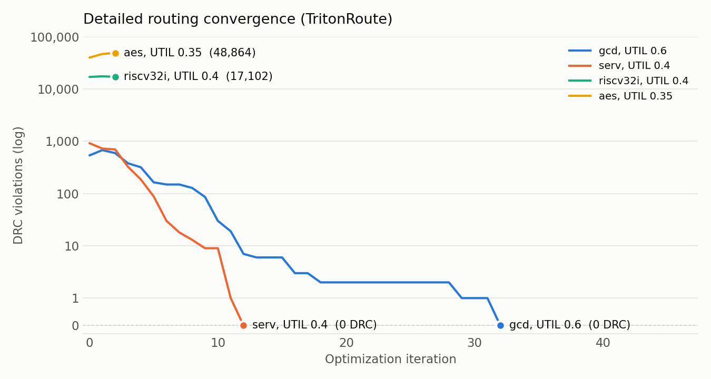

<div align="center">

# i3dPDK_A16K × OpenROAD

**An open-source RTL-to-layout flow for a 16 Å (A16) predictive PDK:<br/>
nanosheet, forksheet and CFET standard cells, buried power rails, 12 nm pins.**

[](https://github.com/The-OpenROAD-Project/OpenROAD)
[](#acknowledgements)
[-d1242f)](#the-platform)
[](#the-platform)


<sub><b>SERV</b> (bit-serial RISC-V), placed and routed on the <b>CFET 3-track</b> library: 7.1 × 7.1 µm, 1,203 cells, <b>0 DRC</b>, clean power grid.</sub>

</div>

---

## Why this exists

Predictive PDKs at the 1.x nm generation let researchers ask *what happens to physical
design when the transistor stacks vertically*. i3dPDK_A16K provides five standard-cell
libraries at the A16 node, from 5-track nanosheet down to 3-track CFET, but taking
a design from RTL to a routed layout on them used to require a commercial tool.

This repository is a complete, scriptable **OpenROAD** flow for i3dPDK_A16K:

- **One command** from a Yosys netlist to a routed DEF, with timing, power, DRC and power-grid reports.
- **Every library** of the PDK: `NSFET_5T`, `FSFET_5T`, `FSFET_4T`, `CFET_4T`, `CFET_3T`.
- **Real geometry (1×)**: 42 nm sites, 54 nm rows, 24 nm M2 pitch, buried power rails (BPR) under every row.
- **A power grid built for BPR**: rails tied to an M8/M9 ring and to M3 stripes by BPR→M3/M9 via stacks, checked with `check_power_grid` after the PDN and after routing.
- **Hard macros** (abstract SRAMs) placed by RTL-MP, with their own power grid.
- **12 benchmark designs** included as netlists (gcd, SERV, AES, RISC-V, Rocket, SweRV, BlackParrot, …).
- Runs entirely in the OpenROAD docker image, with no license and no GUI needed. Layout snapshots are rendered headless.

## Gallery

<table>
<tr>
<td width="50%"></td>
<td width="50%"></td>
</tr>
<tr>
<td><sub><b>Pin access</b> (BPR–M3 only, 1.5 × 1.0 µm). Almost every M1 pin is reached by a stacked via12 + via23; M2 runs east–west, M3 north–south.</sub></td>
<td><sub><b>CFET 3T cells</b> (1.0 × 0.5 µm). Each signal pin is a 12 × 12 nm M1 square; the blue bands are the buried power rails, and the large pads are a BPR→M3 power via stack.</sub></td>
</tr>
<tr>
<td></td>
<td></td>
</tr>
<tr>
<td><sub><b>riscv32i</b> with 4 SRAM macros (25 × 25 µm): RTL-MP macro placement, rows cut around the halos, M8 power stripes stacked down to each macro's M5 straps.</sub></td>
<td><sub><b>AES</b> global-routing congestion (UTIL 0.35). Global routing has no overflow, yet detailed routing does not converge (see <a href="#open-problems">Open problems</a>).</sub></td>
</tr>
</table>

### Same design, four device architectures


<sub>SERV placed at the same utilization (0.4) and drawn at the same scale on four libraries (each with its own synthesized netlist). Stacking nMOS and pMOS (CFET) and cutting tracks shrinks the die to 62 % of the 5-track nanosheet one.</sub>

### Power delivery


Standard cells get power from **buried power rails** (blue, one per row boundary)
instead of M1/M2 rails. The flow ties them up:

- to an **M8/M9 core ring** (green) through BPR→M9 via stacks at the row ends, outside the core where they cannot collide with pins;
- to **M3 VDD/VSS stripe pairs** (magenta, 2 µm pitch) through BPR→M3 stacks inside the core;
- for designs with macros, to **M8 stripes** that also feed each macro's M5 straps.

Detailed placement runs in `-pdn_aware` mode, so no cell pin lands on a power via pad.
The grid is checked with `check_power_grid` right after the PDN (the run stops if it is
not clean) and again after routing.

<br clear="right"/>

## Results

CFET 3-track library, OpenROAD 687848d. All lengths and areas are real (1×).

| Design | UTIL | Die (µm) | Cells | Setup / hold WNS (ns) | Wirelength (µm) | Power (mW) | DRC | Power grid |
|---|---|---|---|---|---|---|---|---|
| gcd (1.0 ns) | 0.6 | 3.62 × 3.62 | 370 | +0.695 / +0.002 | 442 | 0.075 | **0** | clean |
| SERV (0.25 ns) | 0.4 | 7.10 × 7.10 | 1,203 | +0.106 / 0.000 | 1,820 | 1.197 | **0** | clean |

<picture>
  <source media="(prefers-color-scheme: dark)" srcset="docs/images/drt_convergence_dark.png">
  
</picture>

Small designs route to zero violations. Larger ones (AES, riscv32i) get through floorplan,
power grid, placement, CTS, timing repair and global routing without trouble, but
TritonRoute does not converge on them, even at utilizations of 0.35–0.4. Why this
happens is the most interesting part of this PDK; see [Open problems](#open-problems).

## Quick start

**Requirements:** docker, an OpenROAD build with the GUI enabled (for snapshots) built
in the `openroad/ubuntu26.04-dev` image (default `~/OpenROAD/install/bin/openroad`,
override with `OR_BIN` / `OR_IMAGE`), Python 3 with matplotlib and Pillow (plots only),
and the i3dPDK_A16K PDK, which provides the liberty files in `FE/`.

```bash
# inside an i3dPDK_A16K checkout (this repo is its a16k_openroad_enablement/ submodule)
git submodule update --init a16k_openroad_enablement
cd a16k_openroad_enablement

scripts/run_or.sh gcd CFET_3T                              # ~8 min on 8 threads
env UTIL=0.4 OUT_TAG=u40 scripts/run_or.sh serv CFET_3T    # any parameter as an env variable
python3 scripts/summarize.py                               # one line per run (--md for markdown)
```

Used on its own, outside a PDK checkout, set `PDK_ROOT=/path/to/i3dPDK_A16K`.
`PDK_ROOT` must be under `$HOME`, because the container mounts only `$HOME`.

Every run writes `out/<design>/<LIB>/<tag>/`:

| File | Contents |
|---|---|
| `metrics.json`, `rpt/summary.txt` | die, cells (without macros), utilization, WNS/TNS, power, wirelength, DRC count, power-grid status |
| `rpt/{place,cts,grt,final}.rpt` | timing / area / power / DRV per stage |
| `rpt/drc.rpt`, `rpt/pg_*.rpt` | remaining DRC (TritonRoute format), `check_power_grid` results |
| `<top>.def`, `<top>.pnr.v`, `<top>.floorplan.def` | final layout, netlist, floorplan with the PDN |
| `{floorplan,place,cts,grt,route}.odb` | database after each stage |
| `run_params.json`, `openroad.log` | parameters in effect, flow version, full log |

Snapshots and plots like the ones above:

```bash
env SNAP_ODB=out/serv/CFET_3T/u40/route.odb SNAP_PNG=serv.png \
    OR_ENV="SNAP_ODB SNAP_PNG" scripts/openroad.sh -gui -no_init -exit scripts/snapshot.tcl
python3 scripts/plot_drt.py drt.png out/serv/CFET_3T/u40:serv out/gcd/CFET_3T/base:gcd
```

`snapshot.tcl` also takes `SNAP_AREA`, `SNAP_RES`, `SNAP_LAYERS` and
`SNAP_VIEW=route|place|pdn|congestion`.

## The flow


| Stage | What happens |
|---|---|
| read | tech LEF (`_unidir` variant with `ROUTE_UNIDIR=1`), cell LEF, macros, liberty, netlist; SDC with IO delays at 20 % of the period; wire RC per layer from the LEF |
| floorplan | no macros: `initialize_floorplan` at `UTIL`. With macros: the core is sized by shelf-packing the macros (with halos and logic channels) and scanning the aspect ratio, then `rtl_macro_placer` places them and `cut_rows` clears the rows under them |
| power grid | pdngen: M8/M9 ring, BPR follow-pin rails extended to the ring, M3 stripe pairs, macro grids; `check_power_grid` must pass |
| placement | `global_placement -timing_driven -routability_driven`, `repair_design`, `detailed_placement -pdn_aware`, `optimize_mirroring` |
| CTS | `clock_tree_synthesis` (BUF_X1–X8), `repair_clock_nets`, setup + hold `repair_timing` |
| global route | `global_route`, then `repair_timing` inside `-start_incremental` / `-end_incremental`, with the new buffers legalized |
| detailed route | `detailed_route`, up to `DRT_END_ITER` iterations |

Clocks are routed on M4 and above: M2/M3 have about 17× the resistance of M4 at this node,
and a clock on them skewed enough to make hold repair run out of buffers.

### Parameters

Per-design defaults live in `designs/<design>/config.tcl`. Any of them, and any flow
parameter below, can be overridden with an environment variable of the same name.

| Parameter | Default | Meaning |
|---|---|---|
| `CLK_PERIOD_NS` | 1.0 | clock period (also the 3rd argument of `run_or.sh`) |
| `UTIL` | 0.6 | core utilization of the standard cells |
| `PLACE_DENSITY` | UTIL + 0.1 | global placement target density |
| `CORE_MARGIN_UM` | 0.5 | die-to-core margin (holds the ring) |
| `IO_PIN_LAYERS` / `IO_PIN_TRACKS` | 4 / 4 | IO pins on M4/M6/M8/M10 and M5/M7/M9/M11, one every N tracks |
| `MACRO_HALO_UM` | 0.5 | macro halo |
| `MIN_CHANNEL_UM` / `MPL_CHANNEL_UM` | 10 / 4 | logic channel when sizing the core / minimum gap between macro edges with pins (RTL-MP) |
| `MACRO_AREA_SLACK` | 1.25 | area margin for the macros when sizing the core |
| `MIN_ROW_UM` | M3 pitch + 3 × width | shortest row piece kept after cutting rows around macros |
| `PG_M3_PITCH_UM` / `PG_M3_WIDTH_UM` | 2.0 / 0.048 | M3 power stripe pairs (pitch 0 = none) |
| `PG_MACRO_PITCH_UM` | 3.0 | M8 stripe pitch over macro designs |
| `PG_CHECK_ABORT` | 1 | stop if the power grid is not clean after the PDN |
| `SIGNAL_TOP_LAYER` / `CLOCK_LAYERS` | M11 / M4–M11 | routing layers |
| `ROUTE_UNIDIR` | 0 | 1 = unidirectional M1–M3 (`RIGHTWAYONGRIDONLY`) |
| `PIN_ALIGNED_TRACKS` | `ROUTE_UNIDIR` | M1 tracks on the site centres, M2 tracks on the 18 nm M0 grid |
| `GPL_TIMING` / `GPL_ROUTABILITY` | 1 / 1 | global placement modes |
| `GRT_ADJUST` / `GRT_ADJUST_M23` | 0.3 / 0.3 | global routing capacity reduction (M4+ / M2–M3) |
| `CELL_PAD_SITES` | 0 | free sites around each cell during placement |
| `REPAIR_TIMING` / `REPAIR_MAX_BUFFER_PCT` | 1 / 50 | timing repair after CTS and global routing, and its buffer budget |
| `DRT_END_ITER` | 64 | detailed routing iterations |
| `THREADS` | 16 | |
| `STOP_AFTER` | — | `floorplan` / `place` / `cts` / `grt`: write results after that stage and exit |
| `NETLIST` | `designs/<d>/<LIB>/<top>.v.gz` | netlist to use instead |
| `OUT_TAG` | base | run name |

## The platform

| Library | Device | Tracks | Row height | Site |
|---|---|---|---|---|
| `NSFET_5T` | nanosheet | 5 | 90 nm | 42 nm |
| `FSFET_5T` / `FSFET_4T` | forksheet | 5 / 4 | 90 / 72 nm | 42 nm |
| `CFET_4T` / `CFET_3T` | complementary FET (stacked nMOS/pMOS) | 4 / 3 | 72 / 54 nm | 42 nm |

Metal stack: BPR, M0 … M16 (M1–M3 at a 24 nm pitch); liberty at 0.7 V, TT, 27 °C.

`platform/` holds everything this flow needs beyond the PDK's liberty files:

- `lef/i3dPDK_A16K_<N>T_tech[_unidir].lef`: technology LEFs derived from the PDK's `TECH/*_mw.tf`. The `.tf` has no preferred routing directions, no wire R/C and no via resistance, so those are **placeholders**: M1 vertical, alternating above it; R/C as rough A16-class estimates; via R per cut layer. Timing and power are therefore estimates, good for comparisons between runs and libraries, not signoff.
- `lef/<LIB>_cells.lef`: the PDK cell LEFs with the `i3d_16A` site added and coordinates snapped to the 0.5 nm grid. Multi-row cells (DFF, MUX2, XOR, full adder, …) sit on the regular row site; the placer picks rows of matching rail polarity from their BPR pins.
- `macros/`: abstract single-port SRAMs (LEF + liberty) with the pin interface of OpenROAD-flow-scripts' `fakeram`. Their area, pins and timing are assumptions, not PDK data.

`designs/` holds the Yosys netlists (gzip) of 12 designs, 11 from
[OpenROAD-flow-scripts](https://github.com/The-OpenROAD-Project/OpenROAD-flow-scripts)
plus SERV, for `CFET_3T` and `NSFET_5T` (SERV for all five libraries). The PDK has no TIE cells,
so constants are tied logically to VDD/VSS. It has no delay cells either, so hold is
fixed with buffer chains.

## Open problems

Contributions and ideas are very welcome. These are open research questions as much as engineering tasks.

**1. Pin access on 12 nm pins.** Almost every M1 pin is a 12 × 12 nm square centred in its
site, and the pins of a row sit at nearly the same height. A pin covers exactly one M2
track, so the only ways out are a via12 + via23 stack or a one-track wrong-way M2 jog.
Global routing does not see this cost: GRT reports no overflow (M2 44 %, M3 53 %
usage on SERV at 0.6) while the detailed violations pile up in the middle of the die.
The experiments below did not get SERV at UTIL 0.6 to converge (violations after the
first iterations):

| Change | Result |
|---|---|
| baseline | 2,397 → 2,987, diverging |
| M1 opened for routing | 3,332 |
| via-in-pin on M1/M2 | 3,212 |
| M1 tracks aligned to the pins, M1 routing | 1,962 |
| M1 + M3 tracks aligned to the pins | 2,012 |
| M2 pitch 27 nm (a track through every row's pins) | 2,472 |
| cell padding 1–2 sites | GRT overflow, timing repair runs out of buffers |
| M2/M3 GRT capacity reduction 0.5 / 0.7 | 1,922 / 1,423, not converging |

Lower utilization works for small designs (SERV at 0.4 reaches 0) but not for AES or riscv32i.
Pin-access-aware placement (cell flipping, pin-aware spreading) looks like the way forward.

**2. The 4T and 5T libraries do not route yet.** On `NSFET_5T`, `FSFET_4T` and `CFET_4T`, TritonRoute
finds no access point for a handful of pins (DRT-0073, 3–17 pins on SERV) and stops,
both with the LEF tracks and with `PIN_ALIGNED_TRACKS=1`. Floorplan, PDN, placement, CTS
and global routing work on all of them; the [architecture comparison](#same-design-four-device-architectures) above is at the placement stage.

**3. `FSFET_5T`: `MUX2_X1` has no pin geometry for `A`** in the PDK cell LEF. Any netlist
that uses it crashes OpenROAD during placement (SERV does). The included netlists were
synthesized with `MUX2_X1` allowed, so `FSFET_5T` needs a re-synthesis with `MUX2_X1` as `dont_use`.

**4. Unidirectional routing (`ROUTE_UNIDIR=1`).** With the LEF tracks, half of the rows have no
M2 track through their pins (74 pins without an access point on gcd).
`PIN_ALIGNED_TRACKS` fixes access, but those M2 tracks are denser than the M2 minimum
pitch, and gcd converges very slowly (1,473 → 1,308 violations in 8 iterations).

**5. Parasitics.** There is no OpenRCX extraction deck for this PDK. Final timing uses
global-route estimates with the placeholder R/C.

## Repository layout

```
├── flow/
│   ├── flow.tcl          main flow (read → floorplan → PDN → place → CTS → route → reports)
│   ├── floorplan.tcl     core sizing, IO pins, macro placement, row cutting
│   ├── pdn.tcl           power grid (pdngen)
│   └── util.tcl          parameters, wire RC, reports, power-grid checks
├── platform/
│   ├── lef/              tech LEFs (3T/4T/5T, bi- and unidirectional), cell LEFs (5 libraries)
│   └── macros/           abstract SRAM LEF + liberty
├── designs/<design>/     config.tcl and <LIB>/<top>.v.gz
├── scripts/
│   ├── run_or.sh         run one design:  [env VAR=...] run_or.sh <design> <LIB> [period_ns]
│   ├── openroad.sh       OpenROAD in its docker image
│   ├── summarize.py      table of all runs
│   ├── snapshot.tcl      headless layout images
│   └── plot_drt.py       detailed routing convergence plot
└── docs/images/
```

## Acknowledgements

- **i3dPDK_A16K v1.0**, Prof. Taigon Song, I3D VLSI Lab, Kyungpook National University
  (CC BY-NC-SA 4.0). The files in `platform/` are derived from it and carry the same
  license; they are not part of the original PDK.
- [**OpenROAD**](https://github.com/The-OpenROAD-Project/OpenROAD) and
  [**OpenROAD-flow-scripts**](https://github.com/The-OpenROAD-Project/OpenROAD-flow-scripts),
  for the tools and the benchmark designs.
- [**SERV**](https://github.com/olofk/serv) by Olof Kindgren.

If this flow helps your research, a ⭐ helps others find it.
