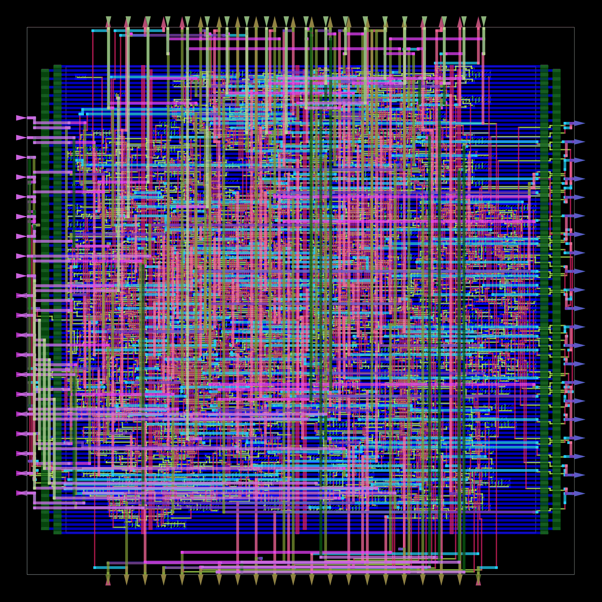
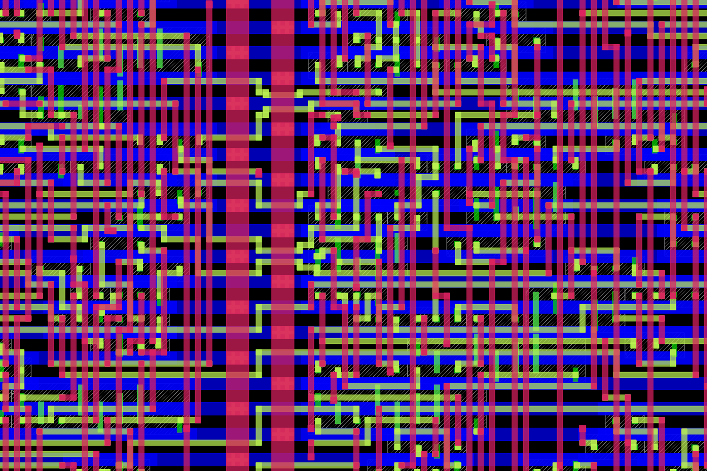
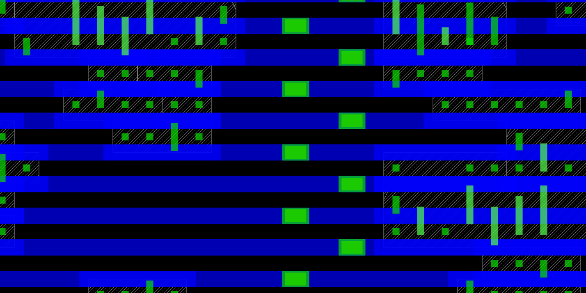
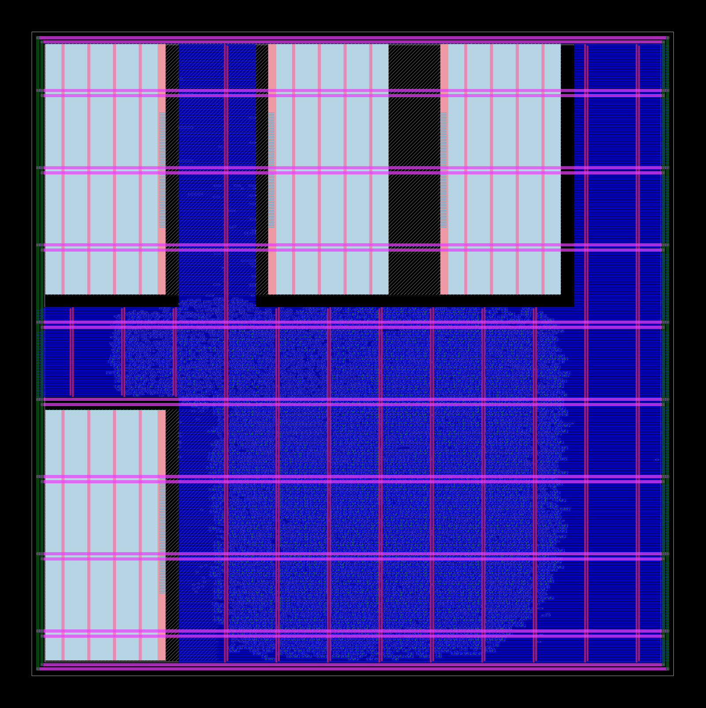
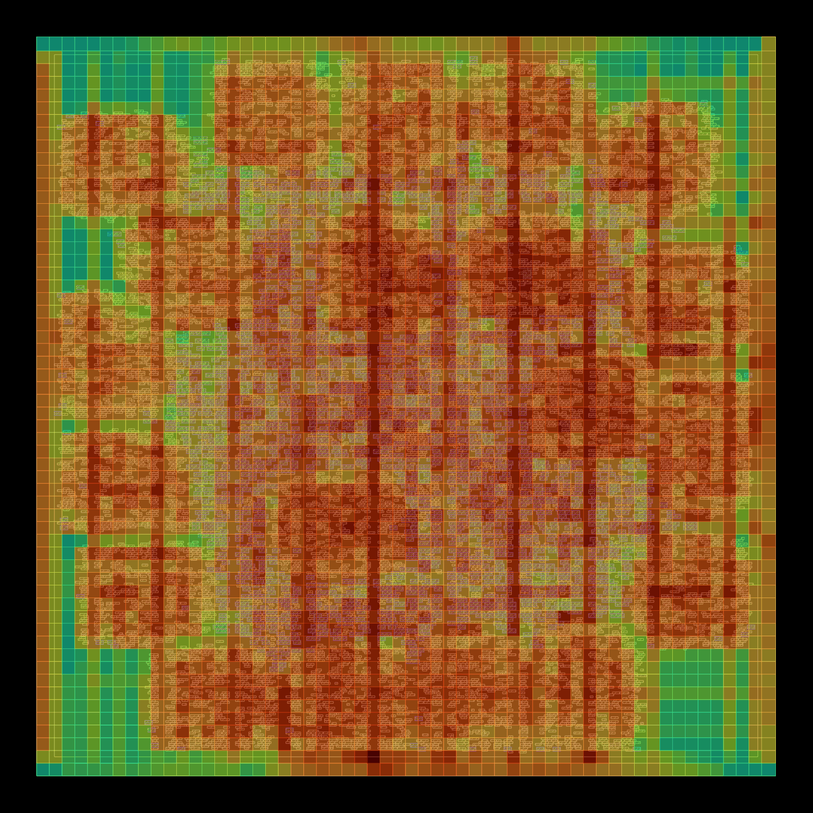
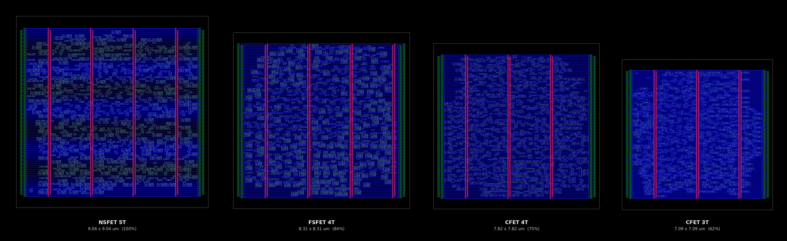
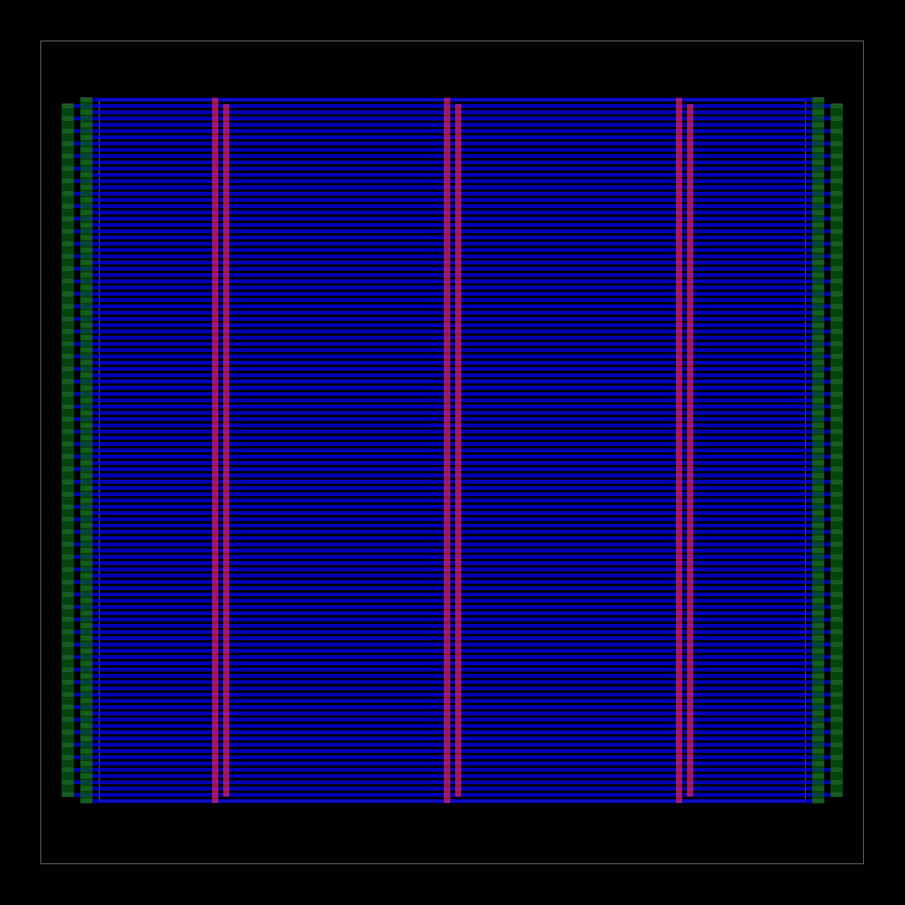
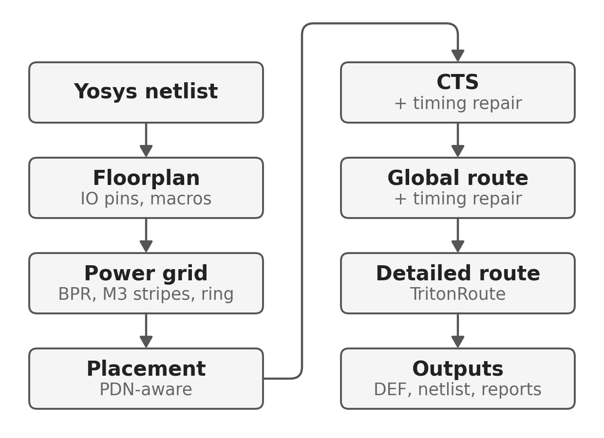
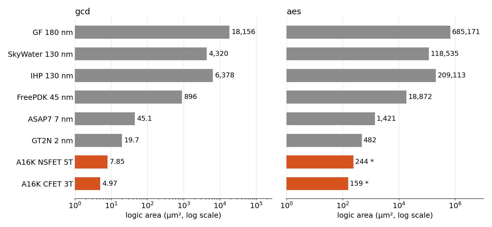
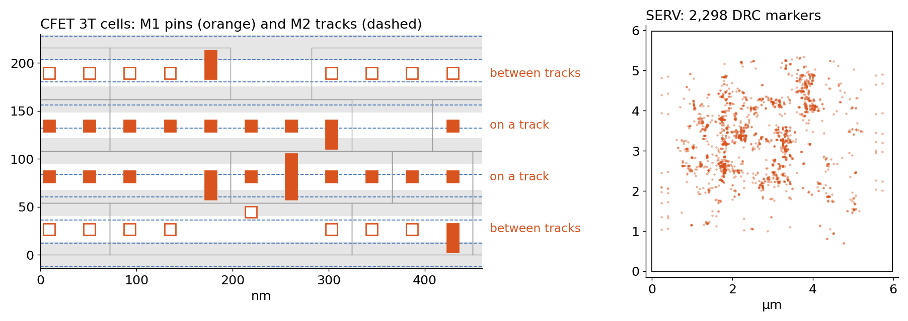

<div align="center">

# OpenROAD for i3dPDK_A16K: open-source RTL-to-layout flow for A16 CFET, forksheet and nanosheet

**An open-source place-and-route flow (OpenROAD, Yosys, TritonRoute) for the 16 Å (A16, 1.6 nm-class) predictive PDK
i3dPDK_A16K: nanosheet (NSFET), forksheet (FSFET) and complementary-FET (CFET) standard cells, buried power rails, 12 nm pins.**

[](https://hub.docker.com/r/openroad/orfs)
[](https://github.com/i3dknu1/i3dPDK_A16K)
[-d1242f)](#the-platform)
[](#the-platform)



<sub><b>SERV</b> (bit-serial RISC-V), placed and routed on the <b>CFET 3-track</b> library: 7.1 × 7.1 µm, 1,203 cells, <b>0 DRC</b>, clean power grid.</sub>

**[Quick start](#quick-start)** · [Gallery](#gallery) · [The flow](#the-flow) · [Technology roadmap](#technology-roadmap) · [vs. a commercial tool](#openroad-vs-a-commercial-tool) · [Open problems](#open-problems)

</div>

---

## Why this exists

Predictive PDKs at the 1.x nm generation let researchers ask *what happens to physical
design when the transistors stack vertically*. [i3dPDK_A16K](https://github.com/i3dknu1/i3dPDK_A16K) has five standard-cell
libraries at the A16 node, from 5-track nanosheet down to 3-track CFET. Until now,
taking a design from RTL to a routed layout on them needed a commercial tool.

This repository (**openroad-i3dpdk-a16k**, formerly i3dPDK_A16K_OpenRoad_Enablement) is a scriptable, open-source **OpenROAD** physical-design flow for i3dPDK_A16K, a CFET / buried-power-rail PDK. It covers
synthesis (Yosys), floorplanning, power-grid generation, placement, clock-tree synthesis, global and detailed
routing (TritonRoute), and timing, power, DRC and power-grid reports:

- **One command** from a Yosys netlist to a routed DEF, with timing, power, DRC and power-grid reports.
- **All five libraries**: `NSFET_5T`, `FSFET_5T`, `FSFET_4T`, `CFET_4T`, `CFET_3T`.
- **Real geometry (1×)**: 42 nm sites, 54 nm rows, 24 nm M2 pitch, a buried power rail (BPR) under every row boundary.
- **A power grid built for BPR**, checked with `check_power_grid` after the PDN and again after routing.
- **Hard macros** (abstract SRAMs) placed by RTL-MP, with their own power grid.
- **12 benchmark designs** included as netlists: gcd, SERV, AES, RISC-V, Rocket, SweRV, BlackParrot, …
- **A [technology roadmap](#technology-roadmap)** from GF 180 nm to GT2N 2 nm, and a **[comparison with a commercial tool](#openroad-vs-a-commercial-tool)** on the same inputs.
- **No commercial tool license, no GUI.** Everything runs in the OpenROAD docker image, layout snapshots included.

### Where it stands

| | Small designs (gcd, SERV) | ~10k cells (aes, riscv32i, dynamic_node) |
|---|---|---|
| Floorplan → global route | works on all five libraries | works on all five libraries |
| Detailed route, `CFET_3T` | **0 DRC** | doesn't converge yet |
| Detailed route, other libraries | **0 DRC** on SERV (3 left on `FSFET_4T`) | doesn't converge yet |

SERV numbers are at UTIL 0.4. A commercial P&R tool closes the larger designs on the same
netlists and LEFs; [the comparison](#openroad-vs-a-commercial-tool) shows where the gap
is. On any library, `STOP_AFTER=grt` gives you a complete placed and globally routed design.

## Quick start

You need **docker** and **git**. OpenROAD, Yosys and the RTL of the benchmark designs all
come in the official [OpenROAD-flow-scripts image](https://hub.docker.com/r/openroad/orfs),
pinned in [`scripts/docker_env.sh`](scripts/docker_env.sh) and pulled on first use
(1.6 GB). Python 3 with matplotlib and Pillow is only needed for the plots.

```bash
git clone https://github.com/i3dknu1/i3dPDK_A16K
cd i3dPDK_A16K
git clone https://github.com/RayChang987/openroad-i3dpdk-a16k a16k_openroad_enablement
cd a16k_openroad_enablement

scripts/run_or.sh gcd CFET_3T                              # ~8 min on 8 threads, ends with 0 DRC
env UTIL=0.4 OUT_TAG=u40 scripts/run_or.sh serv CFET_3T    # any parameter as an env variable
python3 scripts/summarize.py                               # one line per run (--md for markdown)
```

If this repository lives somewhere else, set `PDK_ROOT=/path/to/i3dPDK_A16K`. To use your
own OpenROAD build, set `OR_IMAGE` (an image its binary runs in) and `OR_BIN` (the
binary, under `$HOME` or this repository).

### Other libraries and your own designs

Netlists are included for every design on `CFET_3T` and `NSFET_5T`, and for SERV on all
five libraries. For anything else, [`scripts/syn.sh`](scripts/syn.sh) runs Yosys in the
same image, and `run_or.sh` picks up the result:

```bash
scripts/syn.sh aes FSFET_4T          # -> out/aes/FSFET_4T/syn/aes_cipher_top.v.gz
env STOP_AFTER=grt scripts/run_or.sh aes FSFET_4T
```

A new design needs two files: `designs/<name>/config.tcl` (top module, clock port and
period, utilization, SRAM macros) and `designs/<name>/rtl.tcl` (the RTL file list). The
ORFS designs read their RTL from the image. SERV needs a clone of
[olofk/serv](https://github.com/olofk/serv), see [`designs/serv/rtl.tcl`](designs/serv/rtl.tcl).

### What a run writes

Everything goes to `out/<design>/<LIB>/<tag>/`:

| File | Contents |
|---|---|
| `metrics.json`, `rpt/summary.txt` | die, cells (without macros), utilization, WNS/TNS, power, wirelength, DRC count, power-grid status |
| `rpt/{place,cts,grt,final}.rpt` | timing / area / power / DRV per stage |
| `rpt/drc.rpt`, `rpt/pg_*.rpt` | remaining DRC (TritonRoute format), `check_power_grid` results |
| `<top>.def`, `<top>.pnr.v`, `<top>.floorplan.def` | final layout, netlist, floorplan with the PDN |
| `{floorplan,place,cts,grt,route}.odb` | database after each stage |
| `run_params.json`, `openroad.log` | parameters in effect, flow version, full log |

<details>
<summary><b>Layout snapshots and plots</b></summary>

```bash
env SNAP_ODB=out/serv/CFET_3T/u40/route.odb SNAP_PNG=serv.png \
    OR_ENV="SNAP_ODB SNAP_PNG" scripts/openroad.sh -gui -no_init -exit scripts/snapshot.tcl
python3 scripts/plot_drt.py drt.png out/serv/CFET_3T/u40:serv out/gcd/CFET_3T/base:gcd

# pin-access figure (open problem 1): SERV at UTIL 0.6, two detailed-routing iterations
env UTIL=0.6 DRT_END_ITER=1 OUT_TAG=u60i1 scripts/run_or.sh serv CFET_3T
python3 scripts/plot_pin_access.py pin_access.png out/serv/CFET_3T/u60i1/serv_synth_wrapper.def \
    platform/lef/CFET_3T_cells.lef out/serv/CFET_3T/u60i1/rpt/drc.rpt --window 2.784,2.16,0.46,4

python3 scripts/plot_flow.py                       # the flow diagram
```

`snapshot.tcl` also takes `SNAP_AREA`, `SNAP_RES`, `SNAP_LAYERS` and
`SNAP_VIEW=route|place|pdn|congestion`.

</details>

## Gallery

<table>
<tr>
<td width="50%"></td>
<td width="50%"></td>
</tr>
<tr>
<td><sub><b>Pin access</b> (BPR–M3 only, 1.5 × 1.0 µm). Almost every M1 pin is reached by a stacked via12 + via23. M2 runs east–west, M3 north–south.</sub></td>
<td><sub><b>CFET 3T cells</b> (1.0 × 0.5 µm). Each signal pin is a 12 × 12 nm M1 square. The blue bands are the buried power rails; the large pads are a BPR→M3 power via stack.</sub></td>
</tr>
<tr>
<td></td>
<td></td>
</tr>
<tr>
<td><sub><b>riscv32i</b> with 4 SRAM macros (25 × 25 µm). RTL-MP places the macros, rows are cut around the halos, and M8 power stripes stack down to each macro's M5 straps.</sub></td>
<td><sub><b>AES</b> global-routing congestion (UTIL 0.35). Global routing has no overflow, yet detailed routing doesn't converge (see <a href="#open-problems">Open problems</a>).</sub></td>
</tr>
</table>

### Same design, four device architectures



<sub>SERV on four libraries, placed at the same utilization (0.4) and drawn at the same scale, each with its own synthesized netlist. Stacking nMOS on pMOS (CFET) and cutting tracks shrinks the die to 62 % of the 5-track nanosheet one.</sub>

### Power delivery



Standard cells get power from **buried power rails** (blue, one per row boundary)
instead of M1/M2 rails. The flow ties them up:

- to an **M8/M9 core ring** (green), through BPR→M9 via stacks at the row ends, outside the core where they can't collide with pins;
- to **M3 VDD/VSS stripe pairs** (magenta, 2 µm pitch), through BPR→M3 stacks inside the core;
- in designs with macros, to **M8 stripes** that also feed each macro's M5 straps.

Detailed placement runs with `-pdn_aware`, so no cell pin lands on a power via pad.
`check_power_grid` runs right after the PDN (the run stops if the grid isn't clean) and
again after routing.

<br clear="right"/>

## The flow



| Stage | What happens |
|---|---|
| read | tech LEF (`_unidir` variant with `ROUTE_UNIDIR=1`), cell LEF, macros, liberty, netlist; SDC with IO delays at 20 % of the period; wire RC per layer from the LEF |
| floorplan | no macros: `initialize_floorplan` at `UTIL`. With macros: the core is sized by shelf-packing the macros (with halos and logic channels) and scanning the aspect ratio, then `rtl_macro_placer` places them and `cut_rows` clears the rows under them |
| power grid | pdngen: M8/M9 ring, BPR follow-pin rails extended to the ring, M3 stripe pairs, macro grids; `check_power_grid` must pass |
| placement | `global_placement -timing_driven -routability_driven`, `repair_design`, `detailed_placement -pdn_aware`, `optimize_mirroring` |
| CTS | `clock_tree_synthesis` (BUF_X1–X8), `repair_clock_nets`, setup + hold `repair_timing` |
| global route | `global_route`, then `repair_timing` inside `-start_incremental` / `-end_incremental`, with the new buffers legalized |
| detailed route | `detailed_route`, up to `DRT_END_ITER` iterations |

Clocks are routed on M4 and above. M2/M3 have about 17× the resistance of M4 at this
node, and a clock routed on them skewed so much that hold repair ran out of buffers.

<details>
<summary><b>Parameters</b></summary>

Per-design defaults live in `designs/<design>/config.tcl`. Any of them, and any flow
parameter below, can be overridden with an environment variable of the same name.

| Parameter | Default | Meaning |
|---|---|---|
| `CLK_PERIOD_NS` | 1.0 | clock period (also the 3rd argument of `run_or.sh`) |
| `UTIL` | 0.6 | core utilization of the standard cells |
| `PLACE_DENSITY` | UTIL + 0.1 | global placement target density |
| `CORE_MARGIN_UM` | 0.5 | die-to-core margin (holds the ring) |
| `IO_PIN_LAYERS` / `IO_PIN_TRACKS` | 4 / 4 | IO pins on M4/M6/M8/M10 and M5/M7/M9/M11, one every N tracks |
| `MACRO_HALO_UM` | 0.5 | macro halo |
| `MIN_CHANNEL_UM` / `MPL_CHANNEL_UM` | 10 / 4 | logic channel when sizing the core / minimum gap between macro edges with pins (RTL-MP) |
| `MACRO_AREA_SLACK` | 1.25 | area margin for the macros when sizing the core |
| `MIN_ROW_UM` | M3 pitch + 3 × width | shortest row piece kept after cutting rows around macros |
| `PG_M3_PITCH_UM` / `PG_M3_WIDTH_UM` | 2.0 / 0.048 | M3 power stripe pairs (pitch 0 = none) |
| `PG_MACRO_PITCH_UM` | 3.0 | M8 stripe pitch over macro designs |
| `PG_CHECK_ABORT` | 1 | stop if the power grid is not clean after the PDN |
| `SIGNAL_BOTTOM_LAYER` / `SIGNAL_TOP_LAYER` / `CLOCK_LAYERS` | M2 / M11 / M4–M11 | routing layers (`SIGNAL_BOTTOM_LAYER=M1` opens M1 for signals) |
| `ROUTE_UNIDIR` | 0 | 1 = unidirectional M1–M3 (`RIGHTWAYONGRIDONLY`) |
| `PIN_ALIGNED_TRACKS` | `ROUTE_UNIDIR` | M1 tracks on the site centres, M2 tracks on the 18 nm M0 grid |
| `GPL_TIMING` / `GPL_ROUTABILITY` | 1 / 1 | global placement modes |
| `GRT_ADJUST` / `GRT_ADJUST_M23` | 0.3 / 0.3 | global routing capacity reduction (M4+ / M2–M3) |
| `CELL_PAD_SITES` | 0 | free sites around each cell during placement |
| `REPAIR_TIMING` / `REPAIR_MAX_BUFFER_PCT` | 1 / 50 | timing repair after CTS and global routing, and its buffer budget |
| `DRT_END_ITER` | 64 | detailed routing iterations |
| `THREADS` | 16 | |
| `STOP_AFTER` | — | `floorplan` / `place` / `cts` / `grt`: write results after that stage and exit |
| `NETLIST` | `designs/<d>/<LIB>/<top>.v.gz` | netlist to use instead |
| `PLACED_DEF` | — | route this placed, post-CTS DEF instead (any tool's, 1×): skips floorplan, PDN, placement and CTS, no timing repair |
| `OUT_TAG` | base | run name |

</details>

## The platform

| Library | Device | Tracks | Row height | Site |
|---|---|---|---|---|
| `NSFET_5T` | nanosheet | 5 | 90 nm | 42 nm |
| `FSFET_5T` / `FSFET_4T` | forksheet | 5 / 4 | 90 / 72 nm | 42 nm |
| `CFET_4T` / `CFET_3T` | complementary FET (stacked nMOS/pMOS) | 4 / 3 | 72 / 54 nm | 42 nm |

Metal stack: BPR, M0 … M16, with M1–M3 at a 24 nm pitch. Liberty at 0.7 V, TT, 27 °C.

`platform/` holds everything the flow needs beyond the PDK's liberty files:

- **`lef/i3dPDK_A16K_<N>T_tech[_unidir].lef`**: technology LEFs derived from the PDK's `TECH/*_mw.tf`.
  The `.tf` has no preferred routing directions, no wire R/C and no via resistance, so
  those are **placeholders**: M1 vertical and alternating above it, R/C as rough
  A16-class estimates, via R per cut layer. Timing and power are estimates: fine for
  comparing runs and libraries, not for sign-off.
- **`lef/<LIB>_cells.lef`**: the PDK cell LEFs with the `i3d_16A` site added and
  coordinates on the 0.5 nm grid. Signal pins are snapped outward, so none ends up
  narrower than the PDK draws it ([`scripts/resnap_pins.py`](scripts/resnap_pins.py)).
  Multi-row cells (DFF, MUX2, XOR, full adder, …) sit on the regular row site; the
  placer picks rows of matching rail polarity from their BPR pins.
- **`macros/`**: abstract single-port SRAMs (LEF + liberty) with the pin interface of
  OpenROAD-flow-scripts' `fakeram`. Their area, pins and timing are assumptions, not PDK data.

`designs/` holds the Yosys netlists (gzip) of 12 designs, 11 from
[OpenROAD-flow-scripts](https://github.com/The-OpenROAD-Project/OpenROAD-flow-scripts)
plus SERV, for `CFET_3T` and `NSFET_5T` (SERV for all five libraries). The PDK has no TIE
cells, so constants are tied logically to VDD/VSS. It has no delay cells either, so hold
is fixed with buffer chains.

## Technology roadmap

The same RTL through OpenROAD on six open PDKs from
[OpenROAD-flow-scripts](https://github.com/The-OpenROAD-Project/OpenROAD-flow-scripts)
(including the ones packaged in [lambdapdk](https://pypi.org/project/lambdapdk/)) and on
i3dPDK_A16K, all in the same image. Each ORFS platform uses its own reference setup
(clock, utilization); the A16K runs use the clock of GT2N's reference design.



<sub>Logic area of gcd and aes. Grey: the ORFS platforms. Orange: A16K with this flow. * aes on A16K is measured after global routing.</sub>

These are single example runs, not a calibrated comparison, so check them against your
own settings before quoting them.

<details>
<summary><b>Full numbers: clock, Fmax, area, wirelength, power, energy</b></summary>

**gcd**

| Platform | Clock (ns) | Fmax (GHz) | Logic area (µm²) | Die (µm²) | Wirelength (µm) | Power (mW) | Energy / cycle (pJ) | DRC |
|---|---|---|---|---|---|---|---|---|
| GF 180 nm | 3 | 0.27 | 18,156 | 26,677 | 14,912 | 47 | 141 | 0 |
| SkyWater 130 nm | 1.1 | 0.43 | 4,320 | 6,404 | 7,425 | 5.29 | 5.82 | 0 |
| IHP 130 nm | 1.5 | 0.59 | 6,378 | 34,648 | 10,930 | 3.01 | 4.52 | 0 |
| FreePDK 45 nm | 0.25 | 2.40 | 896 | 1,278 | 4,421 | 3.85 | 0.963 | 0 |
| ASAP7 7 nm | 0.31 | 3.18 | 45.1 | 79 | 812 | 0.64 | 0.199 | 0 |
| GT2N 2 nm | 0.17 | 4.48 | 19.7 | 78.9 | 713 | 0.677 | 0.115 | 0 |
| **A16K NSFET 5T** | 0.17 | 6.33¹ | 7.85 | 18.6 | 471 | 0.574¹ | 0.0976¹ | 0 |
| **A16K CFET 3T** | 0.17 | 7.17¹ | 4.97 | 13.1 | 448 | 0.441¹ | 0.075¹ | 0 |

**aes**

| Platform | Clock (ns) | Fmax (GHz) | Logic area (µm²) | Die (µm²) | Wirelength (µm) | Power (mW) | Energy / cycle (pJ) | DRC |
|---|---|---|---|---|---|---|---|---|
| GF 180 nm | 3 | 0.27 | 685,171 | 1,008,080 | 1,129,235 | 2,475 | 7,425 | 0 |
| SkyWater 130 nm | 3.6 | 0.27 | 118,535 | 225,806 | 571,574 | 70 | 252 | 0 |
| IHP 130 nm | 2 | 0.40 | 209,113 | 284,073 | 627,422 | 75.5 | 151 | 0 |
| FreePDK 45 nm | 0.82 | 1.21 | 18,872 | 62,612 | 223,732 | 47.6 | 39 | 0 |
| ASAP7 7 nm | 0.38 | 2.49 | 1,421 | 2,373 | 50,810 | 18.9 | 7.18 | 0 |
| GT2N 2 nm | 0.35 | 2.77 | 482 | 1,743 | 37,296 | 7.68 | 2.69 | 0 |
| **A16K NSFET 5T** | 0.35 | 2.51¹ | 244 | 465 | 38,265 | 13.5¹ | 4.72¹ | not routed² |
| **A16K CFET 3T** | 0.35 | 2.72¹ | 159 | 312 | 32,535 | 12¹ | 4.2¹ | not routed² |

Logic area counts buffers, inverters, flops and combinational cells, without fill, tap
or endcap cells. Energy per cycle is power × clock period. GT2N and A16K libraries are at
0.7 V typical; GF 180 nm is at its fast corner (1.98 V, 125 °C), which explains its power.

¹ A16K timing and power use placeholder wire R/C (see [The platform](#the-platform)).
They're good for comparing A16K libraries with each other, rough against other PDKs. The
cell area is the PDK's own.<br/>
² Detailed routing of aes on A16K doesn't converge yet ([why](#openroad-vs-a-commercial-tool)),
so this row is taken after global routing. Area and timing are final; wirelength is the
global router's estimate.

To reproduce:

```bash
scripts/orfs_ref.sh gt2n aes                      # any ORFS platform / design, into out/_orfs/
env OUT_TAG=rm350 STOP_AFTER=grt scripts/run_or.sh aes CFET_3T 0.35
env OUT_TAG=p170 scripts/run_or.sh gcd CFET_3T 0.17
python3 scripts/roadmap.py --plot                 # table, docs/roadmap/results.json, figure
```

</details>

## OpenROAD vs. a commercial tool

We ran the same designs from the same inputs through OpenROAD and through a commercial
P&R tool, then had each tool route the other one's placement:

- **Same inputs.** The same Yosys netlists, the same tech, cell and SRAM LEFs, the same power-grid recipe (BPR rails, M3 stripe pairs every 2 µm, M8/M9 ring) and the same utilization, on `CFET_3T`.
- **Hand-off after CTS.** Floorplan, power grid, placement and clock tree go to DEF and are routed by the other tool. The commercial flow reads the LEFs scaled ×4; [`scripts/def_scale.py`](scripts/def_scale.py) converts DEFs between the two scales exactly.
- **Routing.** Signals on M2–M11, M1 for pin access only, bidirectional M1–M3. TritonRoute runs up to 64 iterations, and runs that diverged were stopped. The commercial router runs non-timing-driven, with its early stop off.

Violations after detailed routing, with routed wirelength. Columns read *placed by → routed by*.

| Design | Cells | UTIL | Commercial → commercial | Commercial → TritonRoute | OpenROAD → commercial | OpenROAD → TritonRoute |
|---|---:|---:|---|---|---|---|
| gcd | 264 | 0.6 | **0** (306 µm) | **0** (303 µm) | 3 (374 µm) | **0** (370 µm) |
| serv | 918 | 0.6 | **0** (1,308 µm) | **0** (1,249 µm) | 7 (1,736 µm) | 30* |
| aes | 10,752 | 0.5 | 2 (23,188 µm) | 48,647* | 36 (26,209 µm) | 81,084* |
| riscv32i | 8,158 | 0.6 | 2 (21,437 µm) | 1,984* | 100 (23,070 µm) | 33,536* |
| dynamic_node | 10,972 | 0.6 | **0** (25,120 µm) | 1,549* | 499 (31,590 µm) | 44,166* |

<sub>* Did not converge; the count after the last iteration. Each count comes from that router's own DRC check. The TritonRoute results that reached 0 are clean in the commercial tool's DRC check too.</sub>

<details>
<summary><b>Reproduce the OpenROAD side</b></summary>

```bash
# route a post-CTS DEF from another flow (here: one placed on 4x LEFs)
python3 scripts/def_scale.py placed_4x.def placed_1x.def --scale 1/4 --strip-routing --drop-gcellgrid
env PLACED_DEF=$PWD/placed_1x.def scripts/run_or.sh aes CFET_3T

# hand this flow's post-CTS design to another flow (every run writes <top>.cts.def)
python3 scripts/def_scale.py out/aes/CFET_3T/base/aes_cipher_top.cts.def cts_4x.def \
    --scale 4 --strip-routing --drop-gcellgrid

# one wirelength definition for every router's result
python3 scripts/def_wirelength.py routed.def [--scale 1/4]
```

The commercial tool's scripts are not part of this repository.

</details>

## Open problems

Contributions and ideas are very welcome. These are open research questions as much as
engineering tasks.

### 1. Pin access on 12 nm pins

Most M1 pins are 12 nm squares, and all the pins in a row sit at the same height. A pin
is only half an M2 pitch tall, so at most one M2 track can pass through it.

The rows don't line up with the tracks either. A 54 nm row is 2.25 M2 pitches, so the
tracks shift a little from one row to the next. In the figure below (left), the pins of
two rows sit right on a track, and the pins of the other two rows sit between tracks.
To reach a pin, the router has to stack via12 + via23 on it, or jog off the track on M2.

Global routing doesn't see any of this. On SERV at UTIL 0.6 it reports no overflow (M2
at 44 %, M3 at 53 %). Detailed routing then finds about 2,300 violations, 86 % of them
on M2, mostly in the middle of the die (right).



<sub>Left: four rows of placed CFET 3T cells. Filled pins have an M2 track through them, outlined pins don't. Right: SERV at UTIL 0.6 after two detailed-routing iterations, one dot per DRC marker.</sub>

We tried the changes below. None of them got SERV at UTIL 0.6 to converge (violations
after the first few iterations):

| Change | Result |
|---|---|
| baseline | 2,397 → 2,987, diverging |
| M1 opened for routing | 3,332 |
| via-in-pin on M1/M2 | 3,212 |
| M1 tracks aligned to the pins, M1 routing | 1,962 |
| M1 + M3 tracks aligned to the pins | 2,012 |
| M2 pitch 27 nm (a track through every row's pins) | 2,472 |
| cell padding 1–2 sites | GRT overflow, timing repair runs out of buffers |
| M2/M3 GRT capacity reduction 0.5 / 0.7 | 1,922 / 1,423, not converging |

Lowering the utilization helps small designs (SERV at 0.4 routes to 0), but not AES or
riscv32i.

The [comparison with a commercial tool](#openroad-vs-a-commercial-tool) points to two
separate fixes. The first is a placer that cares about pin access (flipping cells,
spreading pins apart): on the commercial placement, TritonRoute keeps making progress on
riscv32i and dynamic_node, but on its own placement it doesn't. The second is the router
itself: on AES, TritonRoute doesn't converge even on the commercial placement, which the
commercial router finishes with 2 violations.

### 2. Cells left out (`dont_use`)

A few cells in the 4T and 5T libraries cause trouble later in place and route, so we
don't use them ([`platform/dont_use.tcl`](platform/dont_use.tcl)). Synthesis, CTS and
timing repair all skip them, and the included netlists don't contain them.

With that, SERV routes on every library at UTIL 0.4: 0 violations on `CFET_3T`,
`CFET_4T`, `NSFET_5T` and `FSFET_5T`, and 3 on `FSFET_4T`. On the 5T libraries, it's
worth checking the result with your own sign-off DRC.

### 3. Larger designs on the 4T and 5T libraries

As on `CFET_3T`, aes, riscv32i and dynamic_node don't converge in detailed routing. On
`NSFET_5T`, riscv32i and dynamic_node went from about 14,000 to 3,500–4,000 violations in
7 iterations, and were still falling when stopped. On `CFET_4T` they diverged.

### 4. Parasitics

There is no OpenRCX extraction deck for this PDK, so final timing uses global-route
estimates with the placeholder R/C.

## FAQ

**Can OpenROAD place and route CFET or forksheet standard cells?**
Yes, with limits. With this flow OpenROAD places and routes designs on the CFET (3T, 4T), forksheet (4T, 5T)
and nanosheet (5T) libraries of i3dPDK_A16K. Small designs (gcd, SERV) reach 0 DRC; larger ones (aes, riscv32i)
reach global routing but don't converge in detailed routing yet. See [Where it stands](#where-it-stands).

**How do you handle buried power rails (BPR) in OpenROAD?**
pdngen builds BPR follow-pin rails, ties them to an M8/M9 ring and M3 stripe pairs through via stacks, and
`check_power_grid` verifies the result. See [Power delivery](#power-delivery).

**Is there an open-source PDK or flow for sub-2 nm / A16 / 1.6 nm design?**
i3dPDK_A16K is a predictive, academic PDK (not for fabrication). This repository is the open flow for it.
For other nodes, see the [technology roadmap](#technology-roadmap) (GF 180 nm to GT2N 2 nm).

**How does OpenROAD compare with a commercial P&R tool on this PDK?**
Same netlists, LEFs and power grid, each tool routing the other's placement:
[OpenROAD vs. a commercial tool](#openroad-vs-a-commercial-tool).

**Why do 12 nm pins make routing hard?**
A pin is half an M2 pitch tall, so pin access dominates detailed routing: [Open problems](#open-problems).

<sub>Keywords: OpenROAD, OpenROAD-flow-scripts (ORFS), Yosys, TritonRoute, i3dPDK_A16K, A16, 16 Å, 1.6 nm,
CFET, complementary FET, forksheet, nanosheet, GAA, buried power rail (BPR), backside power, standard cells,
RTL-to-layout, physical design, place and route, predictive PDK, EDA, open-source EDA.</sub>

## Repository layout

<details>
<summary><b>Files and what they do</b></summary>

```
├── LICENSE                 CC BY-NC-SA 4.0 (the whole repository)
├── flow/
│   ├── flow.tcl            main flow (read → floorplan → PDN → place → CTS → route → reports)
│   ├── floorplan.tcl       core sizing, IO pins, macro placement, row cutting
│   ├── pdn.tcl             power grid (pdngen)
│   ├── util.tcl            parameters, wire RC, reports, power-grid checks
│   └── syn.tcl             Yosys synthesis (run by scripts/syn.sh)
├── platform/
│   ├── lef/                tech LEFs (3T/4T/5T, bi- and unidirectional), cell LEFs (5 libraries)
│   ├── macros/             abstract SRAM LEF + liberty
│   └── dont_use.tcl        cells no step may use, per library (synthesis, CTS, repair)
├── designs/<design>/       config.tcl, rtl.tcl (RTL for syn.sh) and <LIB>/<top>.v.gz
├── scripts/
│   ├── run_or.sh           run one design:  [env VAR=...] run_or.sh <design> <LIB> [period_ns]
│   ├── syn.sh              synthesize one design:  syn.sh <design> <LIB> [period_ns]
│   ├── openroad.sh         OpenROAD in its docker image
│   ├── docker_env.sh       the image (pinned) and its mounts, for openroad.sh and syn.sh
│   ├── summarize.py        table of all runs
│   ├── snapshot.tcl        headless layout images
│   ├── gui.sh              open a database in OpenROAD's web viewer (or the X11 GUI)
│   ├── export_odb.tcl      DEF + Verilog of a saved database (e.g. cts.odb)
│   ├── resnap_pins.py      re-snap the signal pins of a cell LEF outward from the PDK's own LEF
│   ├── def_scale.py        scale a DEF between 1x and N-x LEFs (cross-tool hand-off)
│   ├── def_wirelength.py   routed wirelength of a DEF, one definition for every router
│   ├── orfs_ref.sh         an ORFS reference design on another platform (technology roadmap)
│   ├── roadmap.py          technology roadmap table, results.json and figure
│   ├── plot_drt.py         detailed routing convergence plot
│   ├── plot_pin_access.py  pin-access figure: pins vs. M2 tracks, where the violations are
│   └── plot_flow.py        the flow diagram
└── docs/
    ├── images/
    ├── xcmp/results.json     results of the comparison with a commercial tool
    └── roadmap/results.json  technology roadmap results
```

</details>

## License

This repository is licensed under
[**CC BY-NC-SA 4.0**](https://creativecommons.org/licenses/by-nc-sa/4.0/) (see [LICENSE](LICENSE)),
the same license as i3dPDK_A16K, from which the files in `platform/` are derived.
Like the PDK, it is for education and academic research only: not for commercial use,
and not for fabrication. If you use it, please also cite the PDK:

> Taigon Song, "i3dPDK_A16K_v1.0", I3DVLSI Laboratory, Kyungpook National Univ., 2026.
> Available at: https://github.com/i3dknu1/i3dPDK_A16K

The benchmark netlists in `designs/` are synthesized from RTL in OpenROAD-flow-scripts;
the original designs keep their own licenses.

## Acknowledgements

- [**i3dPDK_A16K v1.0**](https://github.com/i3dknu1/i3dPDK_A16K), Prof. Taigon Song,
  I3D VLSI Lab, Kyungpook National University (CC BY-NC-SA 4.0). The files in `platform/` are derived from it; they are not part
  of the original PDK.
- [**OpenROAD**](https://github.com/The-OpenROAD-Project/OpenROAD) and
  [**OpenROAD-flow-scripts**](https://github.com/The-OpenROAD-Project/OpenROAD-flow-scripts),
  for the tools and the benchmark designs.
- [**SERV**](https://github.com/olofk/serv) by Olof Kindgren.

If this flow helps your research, a ⭐ helps others find it.
